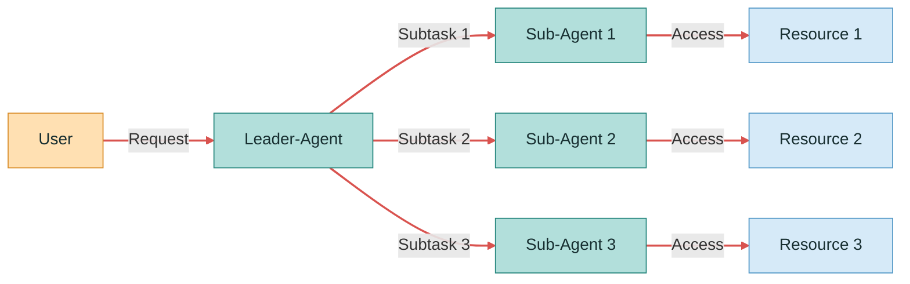

# Batch Authorization Delegation 




Batch Authorization Delegation lets an orchestrator agent request permissions for multiple sub-agents in a single authorization request, reducing repeated user approvals while allowing each sub-agent to obtain only the permissions approved for it.

This Python demo shows a Personal Assistant (Leader Agent) coordinating Calendar and Email Agents to schedule a meeting and notify attendees. Each sub-agent exchanges the Batch Token for an access token containing only its assigned permissions.

Run the demo locally to approve both permissions, just one, or neither, and inspect decoded tokens and resource responses through a web interface. Calendar and email operations are simulated; no external services are required.


## Run

Requires Python 3.11 or later. No third-party dependencies.

Download and extract this repository, then open a terminal in the `demo` directory.

```sh
python leader_agent.py
```

Open http://127.0.0.1:8080/ in your browser and keep the terminal open. Stop with Ctrl+C.

To run the tests:

```sh
python -m unittest -v
```


## Files

- `leader_agent.py`: launcher and workflow
- `authorization_server.py`: consent, token issuance and exchange
- `calendar_agent.py`, `email_agent.py`: Sub-Clients
- `calendar_server.py`, `email_server.py`: resource servers
- `common.py`: shared HTTP helpers
- `view.py`, `page.html`: web interface
- `test_demo.py`: three core tests; run `python -m unittest -v`

Experimental single-domain demo, related to [Batch Authorization Delegation](https://datatracker.ietf.org/doc/draft-ni-oauth-batch-authorization-delegation/). Consent and token validation use private local endpoints; this is not a complete OAuth implementation. Agents are deterministic Python programs. 
